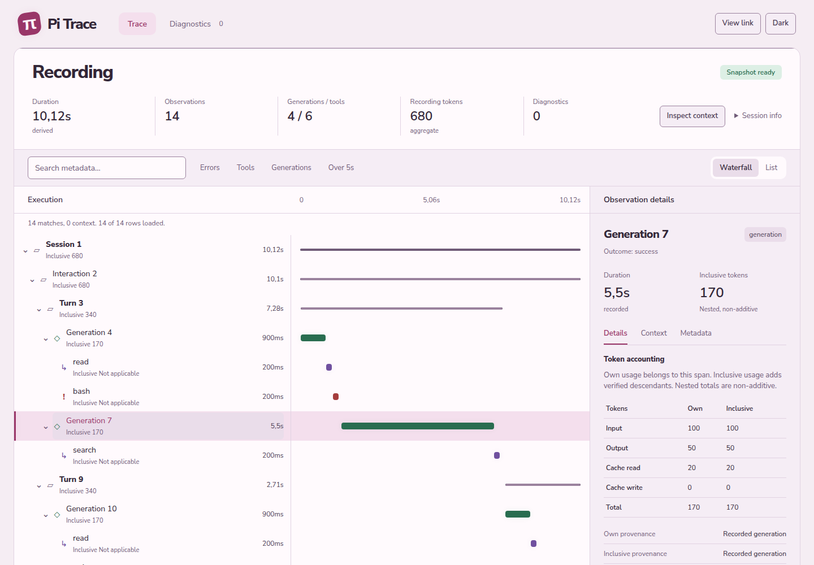

# Pi Trace

A local trace explorer for coding agents. Browse saved Codex, Pi Agent, Claude Code, and OpenCode sessions to inspect execution, timing, token usage, and tool failures. Rust analyzes the evidence; the browser displays it without sending traces to a hosted service.



The example uses fabricated data. Unknown measurements stay explicit, source diagnostics retain their provenance, and recorded prompts and tool output remain hidden until you reveal them.

## Run

With Node.js 24 or newer on Linux x64, start the packaged app in one command:

```sh
npx --yes --package=https://github.com/styrgia/pi-trace-rs/releases/download/v0.2.0/pi-trace-rs-0.2.0.tgz pi-trace-rs system
```

Open [127.0.0.1:4317](http://127.0.0.1:4317). Select a saved session from the catalog. Pi Trace follows persisted updates; unsaved agent output is unavailable. Stop the server with Ctrl+C.

For an existing installation, use `pi-trace-rs system`. To select stores, repeat `--root "pi=./saved sessions"` or `--disable-provider opencode`. See [source configuration and compatibility](docs/upstream-compatibility.md#native-source-configuration).

For collector recordings, use `pi-trace-rs serve "recordings/my session"` to import once or `pi-trace-rs watch "recordings/current session"` to follow complete appended records. An external collector produces these recordings. `watch` requires Unix. Starting without arguments opens an empty workspace.

## Use with Pi

Install from Git, then run these commands in Pi. A source build needs Node.js 24 or newer and stable Rust with Cargo.

```sh
pi install git:github.com/styrgia/pi-trace-rs
```

```text
/pi-trace build
/pi-trace system
/pi-trace stop
```

Use `/pi-trace serve recordings/my session` or `/pi-trace watch recordings/current session` for collector recordings. Paths resolve from the Pi session directory. Spaces need no shell quotes in Pi. Stop the owned server before switching modes or sources.

## Run from source

Install Node.js 24 or newer and stable Rust with Cargo, then clone the repository:

```sh
git clone https://github.com/styrgia/pi-trace-rs.git
cd pi-trace-rs
npm run launch -- system
```

`launch` installs web dependencies, builds the interface and Rust executable, then starts the app. It also accepts `serve "directory"` and `watch "directory"`; without arguments it opens an empty workspace. Use `npm start -- system` to reuse a build, and `npm run check` to verify changes.

See [packaging](docs/packaging.md) for platform limits, [the investigation guide](docs/investigation.md) for controls and content reveal, and [contributing](CONTRIBUTING.md) for development. Use synthetic fixtures; real sessions can contain credentials and private code.

[MIT licensed](LICENSE). Upstream attribution is recorded in [THIRD_PARTY_NOTICES.md](THIRD_PARTY_NOTICES.md).
