# Design

## Context

See [proposal.md](proposal.md) for motivation and scope. All behavior below is proposed.

`Trace::open` currently imports a stable directory and rejects observable source changes. Its builder owns per-source occurrence correlation, then finalization computes usage, completion, diagnostics, and child relationships. Finalization mutates that state and cannot safely run repeatedly on a growing trace.

`Observation` has no usage field. Generation details contain recorded usage, turns use generation aggregates or a turn-summary fallback, and interaction and session aggregates are calculated before child linking. Tools remain unknown even when a child session is linked. Overview sums local turn usage across all sources once. Changing those aggregates directly would double-count children in the overview.

The service holds one ready `Arc<Trace>`. The browser polls only during import and remounts the workbench when the snapshot changes. The launcher keys owned-process reuse by source alone. Existing OpenSpec changes and documentation correctly describe these as offline capabilities.

## Goals / Non-Goals

Goals are a shared semantic engine for offline and live input, immutable coherent views, persistent live span identity, and exact recorded token accounting. Live ingestion and repeated projections must converge on the same settled observations as offline import.

The producer is an external collector writing the documented append-only format. This design adds no capture hooks, session-file reader, RPC adapter, arbitrary filesystem selection, tokenizer, per-component token attribution, or client-specific pinned-history service. Timing retains its existing meanings.

## Decisions

### 1. Add watch mode and one workspace-owned worker

Use `pi-trace-rs watch <directory>`, the native `pi-trace watch <directory>`, and `/pi-trace watch <directory>`. Preserve `serve` and no-argument startup. Parse the Pi command with the existing full-remainder path convention. Resolve relative sources before changing to the package directory. Key launcher reuse by resolved source and mode.

One worker owns source cursors and correlation state. Browser requests enqueue bounded state transitions rather than creating workers. Following has `catchingUp`, `waiting`, `paused`, and `stopped` states. Health remains process readiness. A `session_shutdown` record ends its recorded session, not necessarily the external producer or the watch process.

Automatic watching by default would change established offline semantics. A separate `watch` verb makes the source lifetime explicit without complicating path parsing with flags.

### 2. Share record decoding and correlation, then project repeatedly

Extract the bounded physical-record reader and event reducer from `crates/trace-core/src/import.rs`. Keep offline discovery, source-change checks, and EOF diagnostics. Add a live adapter with per-source validated identity, source-relative key, committed complete-line offset, read high-water offset, physical line, pending bytes, and occurrence state.

At temporary EOF, retain raw pending bytes until a newline completes the physical record. This also handles a UTF-8 sequence split between writes. Even syntactically complete JSON waits for its newline in live mode. Charge new bytes once at the read high-water mark before retention, including pending tails. Unknown and malformed complete records consume their normal budgets. Publish an initial valid empty prefix when no complete observations exist so waiting remains distinct from a stalled import.

Capture a bounded visible prefix for each update, validate its source identities, reduce complete records, then publish only after the update succeeds. Advance committed checkpoints with that publication. A fatal update preserves the previous snapshot and stops the worker. Retry discards unfinished mutable state and starts a new run from the same root.

Separate retained event evidence from derived projections. A projection computes completion, diagnostics, valid links, canonical contributions, and views without mutating accepted evidence. Derived diagnostic identities remain stable. Temporary EOF does not manufacture final missing-end errors. The existing offline finalization policy remains available for a closed import.

The Make Operations Idempotent principle selects this checkpoint and projection model. Repeated scans and projections must preserve occurrence counts, diagnostics, and contributions. Reimporting the entire directory on every tick would repeat decoding and destabilize identity. Directly rerunning today's finalizer would accumulate derived state.

```mermaid
flowchart LR
    Files[Append-only recording sources] --> Reader[Bounded complete-line reader]
    Reader --> Evidence[Rust correlation and retained evidence]
    Evidence --> Projection[Repeatable immutable projection]
    Projection --> Accounting[Canonical and inclusive usage]
    Accounting --> Snapshot[Run and revision snapshot]
    Snapshot --> API[Bounded application views]
    API --> Workbench[Svelte workbench]
```

### 3. Keep source and resource boundaries cumulative

Rescan supported child locations while following, using the existing containment, cycle, and traversal checks. New sources enter the same run but receive independent cursors. Explicit identifiers can resolve relationships later. Discovery order never substitutes for a link.

The current defaults remain 128 MiB total input, 1 MiB per physical record, 100,000 records, and 1,024 sources per run. Existing traversal and inspection budgets also apply. Idle scans and pause do not reset these counters. Read at most 1 MiB or 2,000 complete records in a worker batch, then check cancellation and queued controls. Process backlog without an extra polling delay.

Validate canonical containment, supported regular-file identity, and monotonic file size before accepting an appended prefix. A shrink, replacement, disappearance, same-size metadata change indicating rewriting, or observed committed-boundary mismatch stops following. Platforms without a reliable supported identity check fail explicitly. Do not follow a retargeted root or child symlink.

The supported producer contract forbids changes to consumed bytes. Metadata and boundary checks do not prove the absence of an arbitrary interior rewrite combined with growth. Document this limit rather than claiming a transactional snapshot of arbitrary concurrent filesystem mutation. Such a producer needs a different capture contract.

### 4. Publish runs, revisions, and stable span keys

A watch start or explicit reset creates a fresh `runId`. A semantic publication increments `revision` and creates a distinct immutable `snapshotId`. No-op scans do not create revisions. Workspace status can report waiting or pending bytes without replacing its latest snapshot.

Assign each source a stable key and each occurrence a source-local creation anchor. Allocate an opaque `spanId` from that anchor within the run, including synthetic parents created for missing starts. Appended earlier sources and late relationships cannot change it. Do not base this identity on global vector positions or reused upstream indices. Snapshot node IDs and cursors retain their existing scope.

Retain the current and immediately previous published snapshots for requests. Bound concurrent trace-view handlers to eight and reject excess work with a structural busy response. Release request references promptly. These are retention bounds, not a process-RSS guarantee. A retired snapshot returns `unknown_snapshot` without substituting newer data.

Pause suspends the shared worker at a batch boundary and retains the current snapshot until resume. All tabs observe the same state. This permits detail and reveal requests while paused without client leases or unbounded history. Repeated pause or resume in the corresponding state is idempotent. Resume validates all cursors before catching up. Label the action **Pause updates** to distinguish it from producer control.

### 5. Calculate own and inclusive usage from canonical contributions

Keep a canonical contribution for each generation occurrence with observed usage. Preserve existing first-completion and duplicate diagnostics. A turn-summary fallback has a separate contribution identity owned by its turn and is eligible only while no local generation has any observed usage, including cost-only evidence. Recognized invalid usage also suppresses fallback so a summary cannot hide a recording error. Late generation evidence removes that fallback before projection. Partial generation fields are never filled from the summary.

Generations own their recorded contributions. A turn owns its eligible summary fallback. Other turns, sessions, interactions, and tools have no independently recorded own contribution under the supported format. Their own accounting is not applicable. Expected but unrecorded generation usage is unknown, not zero.

Compute inclusive values in a postorder traversal of the validated execution forest. Each node combines its own canonical contribution and disjoint child contributions. Invalid, cyclic, ambiguous, and missing child links remain excluded with attribution state. A subagent tool can thereby include child model usage. An ordinary tool without recorded model usage or child execution has not-applicable accounting, with an explanation.

Calculate overview usage independently from the canonical contribution table across every source, including unresolved roots. Never sum inclusive parent rows. Use expected generation evidence and unresolved child declarations to qualify coverage. Do not materialize a full contributor set on every ancestor. Store bounded summaries and calculate bounded evidence samples on demand.

For a 150-token parent generation and a linked 40-token child, the parent generation's own amount is 150, its inclusive amount is 190, the tool's inclusive amount is 40, and overview is 190. Attaching an already imported child changes ancestor attribution without changing overview.

### 6. Add exact counter states and bounded provenance

Add `spanUsage` to observations and details. It contains `own`, `inclusive`, and independent child-attribution status. Keep legacy detail `usage` and overview `usage` in their existing local compatibility representation. Add `tokenAccounting` to overview for the canonical exact representation.

Each new token counter has `state` and `value`. States are `exact`, `partial`, `unknown`, `invalid`, and `notApplicable`. Values are canonical unsigned decimal strings or null. A partial value is the sum of known contributions, explicitly labelled as a known subtotal. All-absent evidence stays null. Separate provenance identifies recorded generation, turn-summary fallback, aggregate, or mixed evidence. Generation coverage and fallback use remain visible.

Use the four supported components separately. A valid explicit total can be exact while the component breakdown remains partial. Without an explicit total, derive a total only from all four components. Keep generation context-input tokens tied to its own recorded input, cache-read, and cache-write fields, even when its inclusive value includes child usage.

Validate counters at the JSONL boundary and use checked unsigned arithmetic in projections. Invalid values, overflow, or a conflict between an explicit total and a complete component sum produce dedicated structural usage diagnostics. The affected new counter becomes invalid with null value. Detail evidence retains the reported total and component values with their source references. Independent valid counters survive. Missing cost stays unknown and no pricing or currency conversion is added.

Decimal strings prevent rounding above JavaScript's safe-number range without changing legacy numeric fields. The UI formats these strings losslessly. Row payloads contain bounded summaries only. Details include at most 16 contributor evidence entries with total and omitted counts. Existing 1 MiB response bounds still apply.

### 7. Extend the JSON API and workbench coherently

In watch mode, add a `live` object to the existing workspace variants. It contains run identity, nullable latest revision, follow state, activity, and nullable structural error. Before first publication, workspace remains importing or failed. After publication, a stopped run retains ready state with its last snapshot and a stopped/error live object.

Add `POST /api/v1/live/pause` and `POST /api/v1/live/resume`. They accept no body or query and require the existing approved Origin policy. Non-live requests receive a mode conflict. Extend `POST /api/v1/retry` only for stopped live runs. Reserve the new attempt atomically and retain the existing offline retry behavior. The first successful publication of the new run retires the old run's snapshot references.

Add `GET /api/v1/snapshots/{snapshot}/spans/{spanId}` for bounded detail lookup by stable identity. The returned detail supplies the current snapshot-local node ID for existing content routes. Existing routes, health, Host checks, no-store headers, response limits, and explicit reveal boundaries remain in force. Offline workspace responses need no live object.

The worker checks for new data every 250 ms when caught up. A visible live browser polls lightweight workspace status every 500 ms with one in-flight poll and a bounded timeout. Catch-up processes pending batches immediately. Refresh only on changed run or revision. Slow connections back off and expose reconnecting state. Hidden tabs can suspend polling and resynchronize on visibility. SSE and WebSockets add lifecycle and reconnect machinery without solving source semantics, so they are deferred.

Load metadata against one snapshot into a replacement view model. Cancel and discard superseded requests. Atomically replace the visible overview, rows, and selected detail after validation. Preserve selection through `spanId`, URL-safe presentation state, expansion, and focus. Rebuild previously loaded pages under the new snapshot, bounded to 2,000 retained rows. If that cap prevents restoring the same viewport, retain selection through independent detail lookup and show the loaded-row bound. Never append an old cursor to a new revision.

Pause keeps existing metadata and allows deliberate reveal. On a new selected-span revision, clear revealed bodies and their request identity. Do not fetch replacement bodies automatically. A new run clears old selection and explains the reset. Rows show inclusive tokens with a text label indicating nested totals. The inspector shows own and inclusive component breakdowns, provenance, and coverage. Preserve semantic controls, visible focus, both themes, and narrow layouts.

### 8. Prove the proposed behavior at its actual boundaries

The Prove It Works principle separates artifact validation from feature acceptance. This proposal has no runtime feature evidence. Apply must verify synthetic input through the importer, HTTP service, browser, and extracted package.

Use deterministic writer steps for split lines and UTF-8, malformed complete lines, duplicate completions, reused indices, late summary replacement, child discovery and ambiguity, pause backlogs, source replacement, cumulative limits, precision, and overflow. Compare settled live and offline semantic projections by source occurrence, excluding run, snapshot, and transport identity.

The proposed steady-state latency workload contains at most 10 MiB of input and 10,000 spans, with ten appended records per second. Measure newline flush to a coherent row and inspector update in a visible browser on a recorded local machine. Require every sampled update in a 30-second run to appear within two seconds. This is an acceptance budget, not a measurement or universal performance claim. Record worker CPU and memory during idle and repeated revisions, and check that retained history and diagnostics do not grow with revision count.

## Risks / Trade-offs

- Full projections can become expensive near import limits. Keep append decoding incremental, coalesce publication, calculate inclusive totals in linear graph traversal, and verify the declared latency workload.
- Pause affects all clients of one local service. Expose the shared state in every tab and avoid implying client-specific history pinning.
- Late fallback replacement can decrease displayed totals. Show changed provenance and coverage rather than imposing a monotonic-token assumption.
- Bounded history can retire an in-flight request. Handle `unknown_snapshot` with coherent resynchronization and preserve span identity within the same run.
- Multiple representations can drift. Derive legacy and new usage from the same accepted evidence and freeze legacy contract expectations in tests.
- An append-only writer can violate its contract without every interior rewrite being detectable cheaply. State the contract and stop on observed discontinuity.

## Migration Plan

1. Implement canonical accounting and the shared reducer behind existing offline entry points. Preserve offline contract tests and source diagnostics.
2. Add live ingestion, mode-aware launch and lifecycle, snapshot revisions, and controlled pause and resume.
3. Add the new row and detail contracts, exact decoders, and coherent workbench refresh. Verify offline and live browsing separately.
4. Run `npm run check` and record real-browser evidence. Update compatibility, API, usage, and OpenSpec context only to describe verified behavior.
5. Before distribution, inspect `npm pack` and start an extracted package in watch mode outside the source checkout. Verify append, pause, resume, source paths with spaces, ownership, and shutdown. Follow root-owned versioning and run `npm run version:check` before an authorized commit.

Rollback selects the existing offline `serve` path or the previous package. Sources are never modified and no persistent trace database needs migration. Publishing, committing, and releasing remain separate authorized actions.
